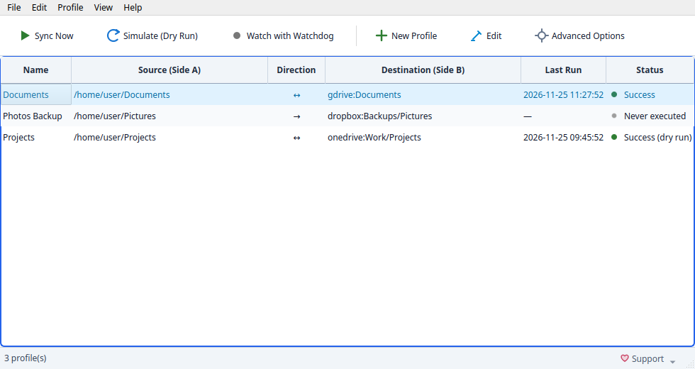
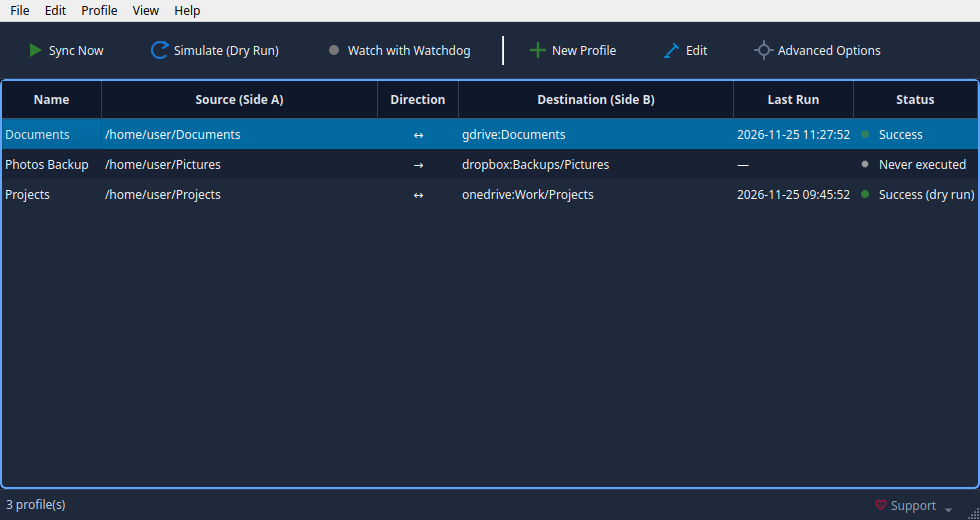
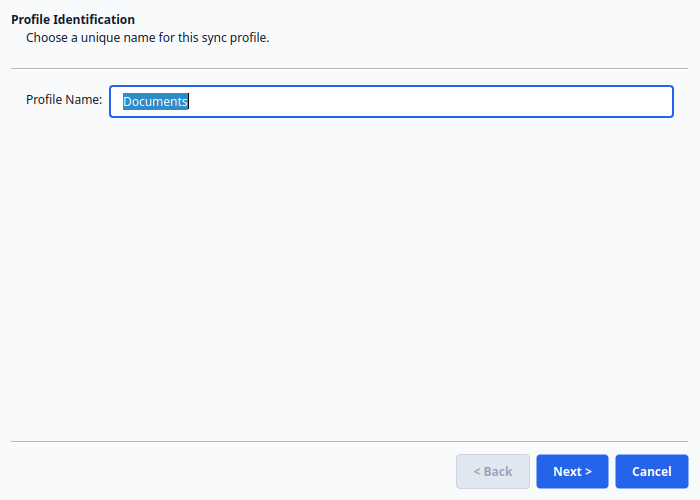
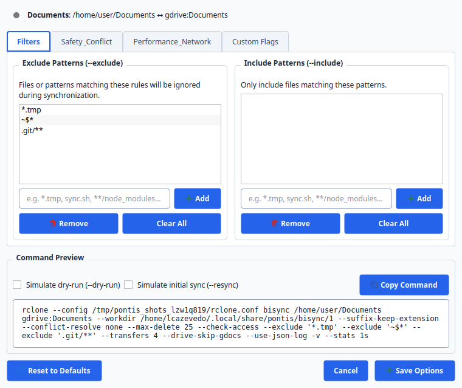
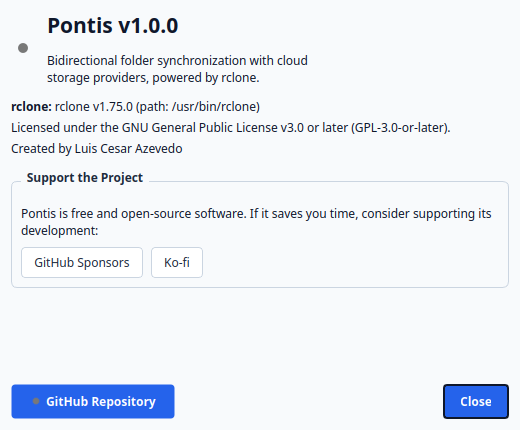

# Pontis

> 🌐 **Language:** **English** | [Português (Brasil)](README.pt-BR.md)

**Pontis** *(Latin: "of the bridge")* is a Linux desktop application in Python/PySide6 for safe, bidirectional file synchronization between local folders and cloud storage providers, powered by [**rclone**](https://rclone.org).

[](https://github.com/lcazevedo/pontis/actions/workflows/ci.yml)
[](LICENSE)
[](https://www.python.org/)
[](https://rclone.org/)
[](#prerequisites)

---

## Why Pontis?

`rclone bisync` supports over 70 cloud providers (Google Drive, OneDrive, Dropbox, S3, SFTP, WebDAV, and more), but running it manually from shell scripts makes it easy to miss safety checks, conflict files, or `--resync` rules.

Pontis wraps `rclone` with a clean desktop interface and built-in data-loss guardrails:

- **Bidirectional by default (`rclone bisync`)** plus one-way sync (`A → B` or `B → A`) when needed.
- **Safety guardrails first:**
  - Mandatory `--dry-run` simulation before the first real execution of any profile.
  - Friendly mass-deletion protection (default limit: **25 files**) with explicit review before deleting above the threshold.
  - Never repeats `--resync` automatically after a failed `bisync` run.
  - Isolated per-profile `--workdir` and `flock` lock to prevent concurrent corruption.
  - `--drive-skip-gdocs` enabled by default for Google Drive remotes.
- **Interactive Conflict Resolution:** detects `*.conflict1` / `*.conflict2` files (local and cloud), previews text diffs/contents, and lets you choose which version to keep.
- **Step-by-Step Profile Wizard & Cloud Browser:** create profiles visually and browse remote folders directly from the GUI.
- **Advanced Options & Live Command Preview:** configure `--include`/`--exclude` filters, conflict policy, `--check-access`, `--bwlimit`, `--transfers`, and extra flags with real-time shell command preview.
- **Execution History & Rotating Logs:** inspect past runs, filter by profile/status, and export full logs.
- **Shell Script Importer & Watchdog:** import existing `sync.sh` scripts, export/import profiles as credential-free JSON, or watch local folders for changes on demand (`watchdog`).
- **Isolated & Secure Credentials:** stores cloud remotes in `~/.config/pontis/rclone.conf` (`0600`) without touching `~/.config/rclone/rclone.conf`, and saves encryption passwords in the OS keyring.
- **Bilingual UI & Themes:** instant live switching between **English** and **Português (Brasil)**, with Light, Dark, and System themes and keyboard accessibility.

---

## Screenshots

### Main Window (Light & Dark)

| Light Theme | Dark Theme |
|---|---|
|  |  |

### Profile Wizard, Advanced Options & About

| Profile Wizard | Advanced Options | About Pontis |
|---|---|---|
|  |  |  |

---

## Prerequisites

- **OS:** Linux (v1 targets Linux; Windows and macOS are planned for future releases).
- **Python:** `3.12` or newer.
- **rclone:** `1.66.0` or newer installed on your system.

Verify your `rclone` installation:

```bash
rclone version
```

If `rclone` is not installed yet, follow the official [rclone installation instructions](https://rclone.org/install/) or install it via your Linux distribution's package manager (make sure the version is `>= 1.66.0`).

---

## Installation

### AppImage (Linux x86_64)

Download `Pontis-1.0.0-x86_64.AppImage` and `Pontis-1.0.0-x86_64.AppImage.sha256` from the [GitHub Releases](https://github.com/lcazevedo/pontis/releases/latest) page (no Python installation required; external `rclone >= 1.66.0` required):

```bash
sha256sum -c Pontis-1.0.0-x86_64.AppImage.sha256
chmod +x Pontis-1.0.0-x86_64.AppImage
./Pontis-1.0.0-x86_64.AppImage
```

To build and verify the AppImage locally from source instead:

```bash
./packaging/linux/build_appimage.sh
```

See [Linux Packaging](packaging/README.md) for AppImage build/Docker verification instructions and the Flatpak manifest.

### From Source

Pontis uses **Conda** (`pontis-dev`) for development and source installs:

```bash
git clone https://github.com/lcazevedo/pontis.git
cd pontis

conda create -n pontis-dev python=3.12
conda activate pontis-dev
pip install -e ".[dev]"
```

Launch the desktop application (defaults to your system language, falling back to English):

```bash
pontis
```

---

## Quick Start

1. **Connect a cloud account** (or import your existing `~/.config/rclone/rclone.conf`):
   ```bash
   # Option A: Import your existing rclone remotes into Pontis's isolated config
   pontis remote import

   # Option B: Create a new Google Drive remote (see Google Client ID guide for best performance)
   pontis remote add gdrive drive
   pontis remote test gdrive
   ```
2. **Create a sync profile:**
   - Open `pontis` and click **New Profile** (`Ctrl+N`) to follow the wizard (or import an existing `sync.sh` via **File → Import Shell Script...**).
3. **Run your first simulation (`--dry-run`) and sync:**
   - Select the profile and click **Sync Now** (`Ctrl+R`).
   - On the first run, Pontis automatically runs a mandatory `--dry-run` simulation and shows what would be copied or deleted.
   - Review the summary and confirm to perform the initial synchronization.

> ⚠️ **Tip:** Always test new profiles against a temporary or test folder (e.g., `PontisTeste/`) before syncing critical personal directories.

---

## CLI Reference

Every core workflow is also available headlessly from the terminal:

```bash
# Manage cloud remotes (stored in ~/.config/pontis/rclone.conf)
pontis remote list
pontis remote add <name> <type> [--param KEY=VALUE] [--non-interactive]
pontis remote test <name> [--path SUBFOLDER]
pontis remote import [--from PATH] [--remote NAME] [--overwrite]
pontis remote remove <name>
pontis remote password set|status|remove

# Manage sync profiles
pontis profile list
pontis profile add <name> --a <local_or_remote> --b <local_or_remote> [--direction bidirectional|a_to_b|b_to_a]
pontis profile remove <name>
pontis profile export [name] [--all] [-o file.json]
pontis profile import <file.json> [--rename | --overwrite]
pontis profile import-script <sync.sh> [--name NAME]

# Run & watch
pontis run <name> [--dry-run] [--skip-first-dry-run]
pontis watch <name> [--debounce 5.0] [--dry-run]
```

Run `pontis --help` or `pontis <subcommand> --help` for full flag details.

---

## Documentation

| Document | Description |
|---|---|
| [User Guide (EN)](docs/USER_GUIDE.md) · [Guia do Usuário (PT-BR)](docs/USER_GUIDE.pt-BR.md) | Complete walkthrough of GUI, conflict resolution, safety limits, and CLI |
| [Google Client ID Guide (EN)](docs/GOOGLE_CLIENT_ID.md) · [PT-BR](docs/GOOGLE_CLIENT_ID.pt-BR.md) | Creating your own OAuth `client_id` for Google Drive |
| [FAQ (EN)](docs/FAQ.md) · [Perguntas Frequentes (PT-BR)](docs/FAQ.pt-BR.md) | Answers on `bisync`, `--resync`, safety limits, and data paths |
| [Architecture Proposal](docs/PROPOSTA_ARQUITETURA.md) | High-level system architecture and design |
| [Architecture Decision Records (ADRs)](docs/adr/README.md) | Key technical decisions and trade-offs |
| [Work Plan](docs/PLANO_DE_TRABALHO.md) | Project roadmap and milestone log |
| [Third-Party Licenses](THIRD_PARTY_LICENSES.md) | Dependencies and license inventory |

---

## Support the Project

Pontis is free, open-source software released under the GPL-3.0-or-later license, with no ads, no telemetry, and no locked features.

If Pontis saves you time and you would like to support its maintenance on a voluntary basis:

- 💖 [GitHub Sponsors](https://github.com/sponsors/lcazevedo)
- ☕ [Ko-fi](https://ko-fi.com/lcazevedo)

---

## Contributing & Security

- Read [CONTRIBUTING.md](CONTRIBUTING.md) for development setup, tests (`pytest`, `ruff`, `mypy`), and coding guidelines.
- Participation is governed by our [Code of Conduct](CODE_OF_CONDUCT.md).
- To report a security issue privately, see [SECURITY.md](SECURITY.md).
- See [CHANGELOG.md](CHANGELOG.md) for release history.

## License

Licensed under the **GNU General Public License v3.0 or later (`GPL-3.0-or-later`)**. See [LICENSE](LICENSE).
