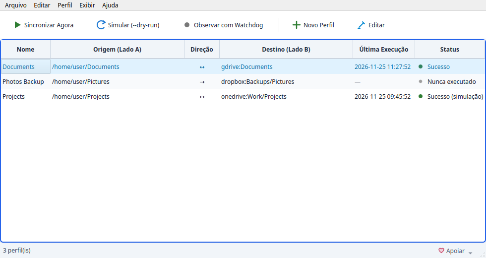
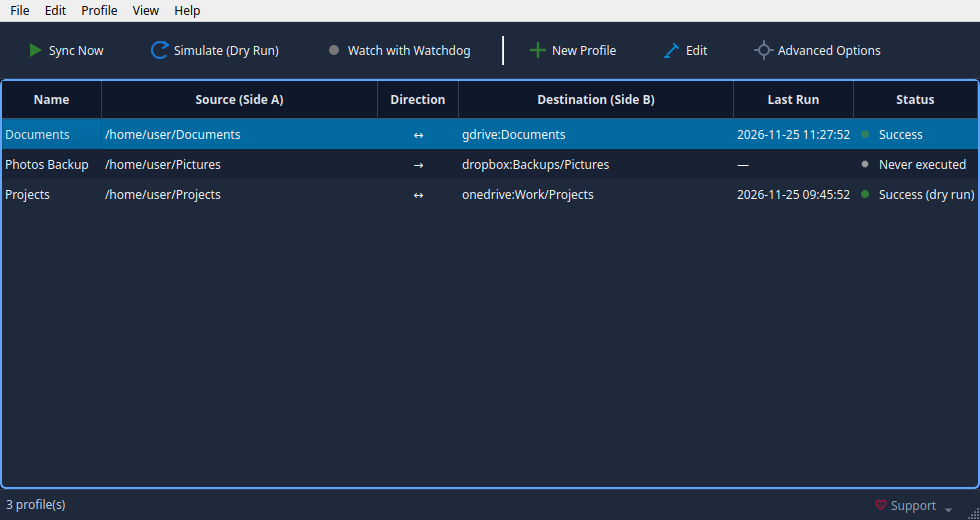
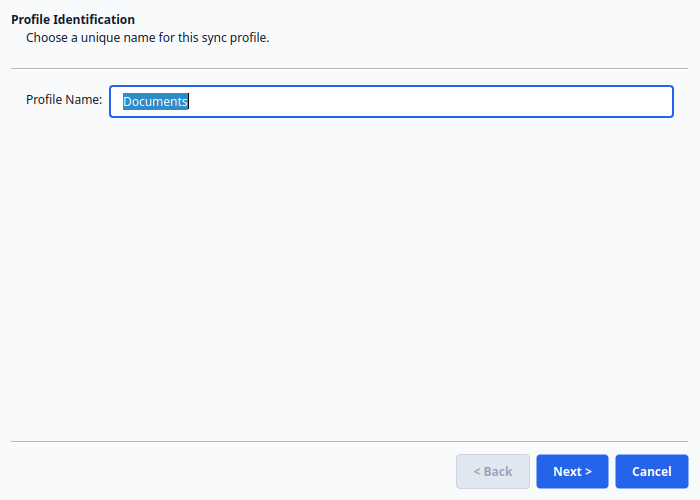
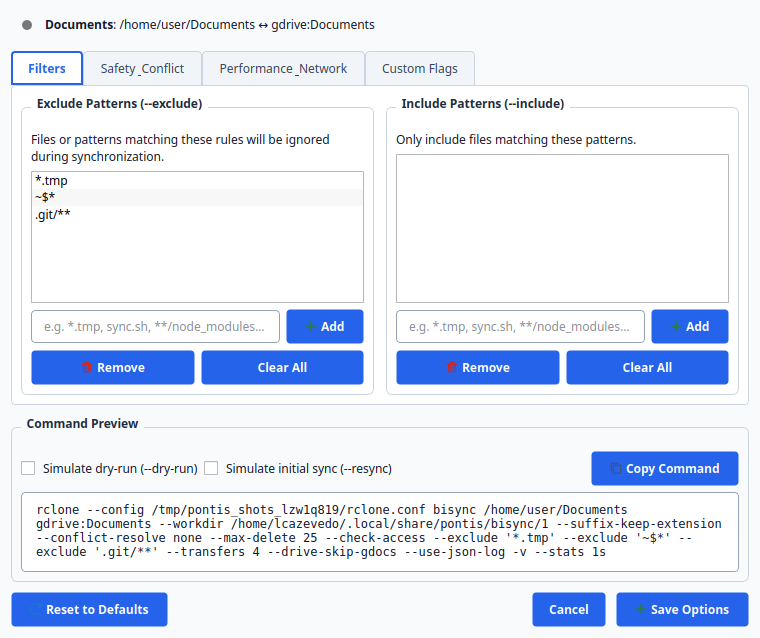
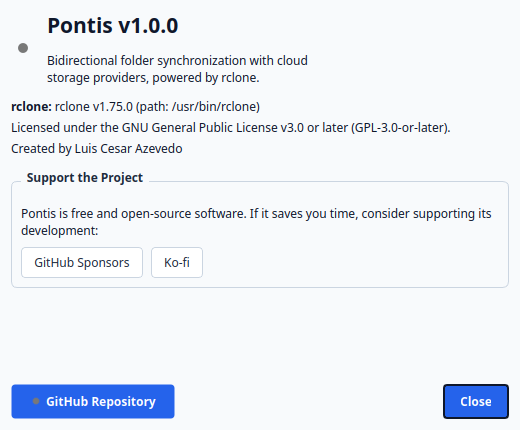

# Pontis

> 🌐 **Idioma:** [English](README.md) | **Português (Brasil)**

**Pontis** *(latim: "da ponte")* é um aplicativo desktop para Linux em Python/PySide6 para sincronização bidirecional segura entre pastas locais e provedores de nuvem, usando o [**rclone**](https://rclone.org).

[](https://github.com/lcazevedo/pontis/actions/workflows/ci.yml)
[](LICENSE)
[](https://www.python.org/)
[](https://rclone.org/)
[](#pré-requisitos)

---

## Por que usar o Pontis?

O `rclone bisync` suporta mais de 70 provedores de nuvem (Google Drive, OneDrive, Dropbox, S3, SFTP, WebDAV e outros), mas usá-lo apenas por scripts manuais facilita esquecer verificações de segurança, arquivos de conflito ou regras de `--resync`.

O Pontis oferece uma interface gráfica simples com proteções contra perda de dados integradas:

- **Bidirecional por padrão (`rclone bisync`)**, além de sincronização unidirecional (`A → B` ou `B → A`) quando necessário.
- **Proteções de segurança integradas:**
  - Simulação obrigatória (`--dry-run`) antes da primeira sincronização real de qualquer perfil.
  - Proteção amigável contra exclusão em massa (limite padrão: **25 arquivos**), exigindo revisão explícita antes de apagar acima do limite.
  - Nunca repete `--resync` automaticamente após uma falha do `bisync`.
  - `--workdir` isolado por perfil e trava `flock` para impedir execuções simultâneas do mesmo perfil.
  - `--drive-skip-gdocs` ativado por padrão para remotos do Google Drive.
- **Resolução interativa de conflitos:** detecta arquivos `*.conflict1` / `*.conflict2` (locais e na nuvem), exibe pré-visualização e permite escolher qual versão manter.
- **Assistente passo a passo e navegador de pastas:** crie perfis visualmente e navegue por diretórios locais e na nuvem direto pela interface.
- **Opções avançadas com prévia ao vivo:** configure filtros `--include`/`--exclude`, política de conflito, `--check-access`, `--bwlimit`, `--transfers` e flags extras vendo o comando final montado em tempo real.
- **Histórico e logs rotativos:** consulte execuções anteriores, filtre por perfil/status e exporte logs completos.
- **Importador de script e observação em tempo real:** importe um `sync.sh` existente, exporte/importe perfis em JSON (sem credenciais) ou observe pastas locais sob demanda (`watchdog`).
- **Credenciais isoladas e seguras:** salva remotos em `~/.config/pontis/rclone.conf` (`0600`) sem alterar seu `~/.config/rclone/rclone.conf`, e armazena senhas de criptografia no *keyring* do sistema.
- **Bilíngue e acessível:** troca imediata em tempo de execução entre **Português (Brasil)** e **English**, temas Claro, Escuro e Sistema, além de atalhos de teclado.

---

## Capturas de tela

### Janela Principal (Português & Tema Escuro)

| Tema Claro (PT-BR) | Tema Escuro (EN) |
|---|---|
|  |  |

### Assistente, Opções Avançadas e Sobre

| Assistente de Perfil | Opções Avançadas | Sobre o Pontis |
|---|---|---|
|  |  |  |

---

## Pré-requisitos

- **Sistema:** Linux (a v1 tem foco em Linux; Windows e macOS estão previstos para versões futuras).
- **Python:** `3.12` ou superior.
- **rclone:** versão `1.66.0` ou superior instalada no sistema.

Verifique a versão instalada do `rclone`:

```bash
rclone version
```

Se ainda não tiver o `rclone` instalado, siga as [instruções oficiais de instalação do rclone](https://rclone.org/install/) ou instale pelo gerenciador de pacotes da sua distribuição (garantindo versão `>= 1.66.0`).

---

## Instalação

### AppImage (Linux x86_64)

Baixe `Pontis-1.0.0-x86_64.AppImage` e `Pontis-1.0.0-x86_64.AppImage.sha256` na página de [GitHub Releases](https://github.com/lcazevedo/pontis/releases/latest) (não exige Python instalado; requer apenas `rclone >= 1.66.0` no sistema):

```bash
sha256sum -c Pontis-1.0.0-x86_64.AppImage.sha256
chmod +x Pontis-1.0.0-x86_64.AppImage
./Pontis-1.0.0-x86_64.AppImage
```

Se preferir gerar e validar o AppImage localmente a partir do código-fonte:

```bash
./packaging/linux/build_appimage.sh
```

Veja [Empacotamento Linux](packaging/README.md) para detalhes do build, verificação em container Docker limpo e manifesto Flatpak.

### A partir do código-fonte

O Pontis usa **Conda** (`pontis-dev`) durante o desenvolvimento e instalação local:

```bash
git clone https://github.com/lcazevedo/pontis.git
cd pontis

conda create -n pontis-dev python=3.12
conda activate pontis-dev
pip install -e ".[dev]"
```

Para abrir a interface gráfica (segue automaticamente o idioma do sistema, com inglês como padrão/fallback):

```bash
pontis
```

---

## Primeiros passos

1. **Conecte uma conta na nuvem** (ou importe seu `~/.config/rclone/rclone.conf` existente):
   ```bash
   # Opção A: Importar remotos já configurados para o arquivo isolado do Pontis
   pontis remote import

   # Opção B: Adicionar uma nova conta Google Drive (veja o guia de client_id para melhor desempenho)
   pontis remote add gdrive drive
   pontis remote test gdrive
   ```
2. **Crie um perfil de sincronização:**
   - Abra o `pontis` e clique em **Novo Perfil** (`Ctrl+N`) para seguir o assistente (ou importe um `sync.sh` em **Arquivo → Importar Script Shell...**).
3. **Faça a primeira simulação (`--dry-run`) e sincronize:**
   - Selecione o perfil e clique em **Sincronizar agora** (`Ctrl+R`).
   - Na primeira execução, o Pontis realiza uma simulação `--dry-run` obrigatória e exibe o resumo do que será copiado ou excluído.
   - Revise o resumo e confirme para executar a sincronização real.

> ⚠️ **Dica de segurança:** sempre valide novos perfis com uma pasta de testes (ex.: `PontisTeste/`) antes de apontar para pastas pessoais importantes.

---

## Referência rápida do CLI

Todas as operações principais também estão disponíveis pelo terminal:

```bash
# Gerenciar contas na nuvem (salvas em ~/.config/pontis/rclone.conf)
pontis remote list
pontis remote add <nome> <tipo> [--param CHAVE=VALOR] [--non-interactive]
pontis remote test <nome> [--path SUBPASTA]
pontis remote import [--from CAMINHO] [--remote NOME] [--overwrite]
pontis remote remove <nome>
pontis remote password set|status|remove

# Gerenciar perfis de sincronização
pontis profile list
pontis profile add <nome> --a <local_ou_remoto> --b <local_ou_remoto> [--direction bidirectional|a_to_b|b_to_a]
pontis profile remove <nome>
pontis profile export [nome] [--all] [-o arquivo.json]
pontis profile import <arquivo.json> [--rename | --overwrite]
pontis profile import-script <sync.sh> [--name NOME]

# Executar e observar
pontis run <nome> [--dry-run] [--skip-first-dry-run]
pontis watch <nome> [--debounce 5.0] [--dry-run]
```

Use `pontis --help` ou `pontis <subcomando> --help` para ver todas as opções.

---

## Documentação

| Documento | Descrição |
|---|---|
| [Guia do Usuário (PT-BR)](docs/USER_GUIDE.pt-BR.md) · [User Guide (EN)](docs/USER_GUIDE.md) | Passo a passo da interface, resolução de conflitos, proteções e CLI |
| [Guia de Client ID do Google (PT-BR)](docs/GOOGLE_CLIENT_ID.pt-BR.md) · [EN](docs/GOOGLE_CLIENT_ID.md) | Como criar seu próprio `client_id` OAuth para Google Drive |
| [Perguntas Frequentes (PT-BR)](docs/FAQ.pt-BR.md) · [FAQ (EN)](docs/FAQ.md) | Dúvidas comuns sobre `bisync`, `--resync`, limites de exclusão e caminhos |
| [Proposta de Arquitetura](docs/PROPOSTA_ARQUITETURA.md) | Visão geral da arquitetura e decisões técnicas |
| [Registros de Decisão (ADRs)](docs/adr/README.md) | Histórico das decisões arquiteturais do projeto |
| [Plano de Trabalho](docs/PLANO_DE_TRABALHO.md) | Roteiro de entregas e registro de decisões |
| [Licenças de Terceiros](THIRD_PARTY_LICENSES.md) | Inventário de dependências e licenças |

---

## Apoie o projeto

O Pontis é um software livre e gratuito sob licença GPL-3.0-or-later, sem anúncios, sem telemetria e sem recursos bloqueados.

Se o Pontis economiza seu tempo no dia a dia e você quiser apoiar a manutenção do projeto de forma totalmente voluntária:

- 💖 [GitHub Sponsors](https://github.com/sponsors/lcazevedo)
- ☕ [Ko-fi](https://ko-fi.com/lcazevedo)

---

## Contribuição e Segurança

- Consulte [CONTRIBUTING.md](CONTRIBUTING.md) para configurar o ambiente de desenvolvimento, rodar testes (`pytest`, `ruff`, `mypy`) e seguir as convenções.
- A convivência na comunidade segue nosso [Código de Conduta](CODE_OF_CONDUCT.md).
- Para reportar vulnerabilidades de segurança em privado, veja [SECURITY.md](SECURITY.md).
- Veja [CHANGELOG.md](CHANGELOG.md) para o histórico de mudanças.

## Licença

Distribuído sob a licença **GNU General Public License v3.0 ou posterior (`GPL-3.0-or-later`)**. Veja [LICENSE](LICENSE).
