# Pontis — Plano de Trabalho

Cada **Parte** é entregue isoladamente e termina com um **critério de teste** para você validar antes de pedirmos a próxima. Peça: *"Faça a Parte N"*.

**Escopo da v1:** Linux, sincronização manual, GPL-3.0-or-later, rclone (híbrido), SQLite, PT-BR + EN.
**Fora da v1:** agendamento, Windows, macOS, empacotamento do rclone.

```mermaid
flowchart LR
    P0[0 Fundação] --> P1[1 Domínio e SQLite] --> P2[2 Rclone e CLI] --> P3[3 Contas na nuvem]
    P3 --> P4[4 GUI base] --> P5[5 Assistente] --> P6[6 Avançado] --> P7[7 Execução na GUI]
    P7 --> P8[8 Histórico e conflitos] --> P9[9 Importador e extras] --> P10[10 i18n e polimento]
    P10 --> P11[11 Documentação] --> P12[12 Empacotamento Linux] --> P13[13 CI e GitHub] --> P14[14 Release 1.0]
```

---

## Parte 0 — Fundação do projeto
**Status:** ✅ Concluída (2026-10-31), aguardando validação do usuário

**Escopo (somente isto):** preparar o projeto vazio e o ambiente. Nenhuma funcionalidade do app.
- Ambiente **conda** `pontis-dev` (Python 3.12), **sem venv**. Instalação com `pip install -e ".[dev]"`.
- Repositório: `git init` e primeiro commit. `.gitignore`, `.editorconfig`.
- `pyproject.toml` com metadados (nome `pontis`, licença `GPL-3.0-or-later`), dependências (PySide6, platformdirs, keyring) e extra `dev` (ruff, mypy, pytest, pytest-qt, pre-commit).
- `LICENSE` (texto da GPL-3.0), cabeçalhos SPDX, `README.md` mínimo.
- Esqueleto `src/pontis/` (`__init__.py`, `__main__.py`) e `tests/` com um teste simples.
- `ruff`, `mypy`, `pytest` e `pre-commit` configurados.
- VS Code: `.vscode/settings.json` e `launch.json` apontando para o ambiente `pontis-dev`.
- Janela vazia do PySide6 abrindo (prova do ambiente).
- Pasta de testes: orientar o usuário a criar `PontisTeste/` no Drive (o agente não cria nem usa nada na nuvem nesta parte).
- **Não fazer:** modelos, banco, rclone, telas reais, i18n completo.
- **Teste:** `conda activate pontis-dev`, `pontis` abre uma janela em branco; `pytest`, `ruff check` e `mypy` passam.

## Parte 1 — Domínio e persistência (SQLite)
**Status:** ✅ Concluída (2026-10-31), aguardando validação do usuário

- Modelos: `SyncProfile`, `Endpoint`, `SyncOptions`, `Schedule` (só `manual`), `RunResult`.
- SQLite com migrações versionadas, diretórios via `platformdirs`; repositórios (CRUD de perfis, histórico).
- Coluna `schedule` reservada para o futuro.
- **Teste:** testes unitários passam; criar, editar e excluir um perfil por script e ver o banco persistir.

## Parte 2 — Motor rclone e CLI
**Status:** ✅ Concluída (2026-10-31), aguardando validação do usuário

- Localizar rclone (app → `PATH` → orientação), checar versão mínima.
- `RcloneAdapter`: montar comando do `bisync`, `--resync` automático na primeira vez (com segurança), `--dry-run`, `--max-delete`, lock por perfil, leitura do `--use-json-log`.
- CLI: `pontis profile add|list|remove`, `pontis run <perfil> [--dry-run]`.
- **Teste:** com pastas locais temporárias, `pontis run` sincroniza nos dois sentidos. Depois, reproduzir seu `sync.sh` (SENAI ↔ gdrive) com `--dry-run` e então de verdade.

## Parte 3 — Contas em nuvem (remotos)
**Status:** ⬜ Pendente

- `RemoteService`: listar, criar (fluxo OAuth), testar e remover remotos num `rclone.conf` próprio do app.
- Opção de importar o `rclone.conf` existente; suporte a senha do config via `keyring`.
- Comandos CLI: `pontis remote add|list|test|remove`.
- **Teste:** adicionar uma conta Google Drive (ou importar a existente), listar e testar a conexão.

## Parte 4 — GUI base
**Status:** ⬜ Pendente

- Janela principal: tabela de sincronizações, barra de ações, estados (vazio, lista).
- Navegação, ícones, tema claro/escuro, camada de i18n já em uso nas strings (PT-BR e EN).
- Dados vindos do SQLite.
- **Teste:** os perfis criados pelo CLI aparecem na janela, que pode excluí-los.

## Parte 5 — Assistente de criação/edição
**Status:** ⬜ Pendente

- Passos: nome → lado A → lado B → direção → conflito → resumo.
- Seletor de local ou remoto, navegador de pastas (local e nuvem), validação em cada passo.
- Reserva visual para agendamento (desativada ou oculta).
- **Teste:** criar e editar um perfil local ↔ Google Drive só pela interface.

## Parte 6 — Janela de opções avançadas
**Status:** ⬜ Pendente

- Filtros include/exclude, `max-delete`, `check-access`, limite de banda, transferências paralelas, política de conflito, flags livres com validação.
- Pré-visualização do comando final.
- **Teste:** reproduzir os `--exclude` do seu `sync.sh` pela janela e conferir o comando exibido.

## Parte 7 — Execução na GUI
**Status:** ⬜ Pendente

- Botão *Sincronizar agora*, `--dry-run` obrigatório na primeira execução (com resumo do que mudará), confirmação de exclusões em massa.
- Progresso em tempo real, cancelar, bloqueio contra execução dupla, notificações do sistema.
- **Teste:** sincronizar a pasta SENAI pela interface, com a simulação, o progresso e o resultado.

## Parte 8 — Histórico, logs e conflitos
**Status:** ⬜ Pendente

- Tela de histórico por perfil e execução, logs rotativos, exportação de log.
- Tratamento de erros do bisync (inclusive pedido de `--resync`, nunca automático após falha).
- Tela de resolução de conflitos.
- **Teste:** provocar um conflito (editar o mesmo arquivo nos dois lados) e resolvê-lo; consultar o histórico.

## Parte 9 — Importador e extras
**Status:** ⬜ Pendente

- Importar `sync.sh` (pastas e `--exclude`).
- Exportar e importar perfis (sem segredos).
- Observação de mudanças com `watchdog` (opcional, sob demanda).
- **Teste:** importar o seu `sync.sh` e obter um perfil equivalente.

## Parte 10 — Idiomas e polimento
**Status:** ⬜ Pendente

- Revisão completa PT-BR e EN, seletor de idioma nas Preferências, acessibilidade (teclado, contraste).
- Tela de Preferências (idioma, caminho do rclone, tema), aviso de nova versão.
- **Teste:** trocar o idioma em tempo de execução e percorrer todas as telas.

## Parte 11 — Documentação profissional
**Status:** ⬜ Pendente

- `README.md` e `README.pt-BR.md` com capturas de tela, `CONTRIBUTING.md`, `CODE_OF_CONDUCT.md`, `SECURITY.md`, `CHANGELOG.md`.
- Guia do usuário, guia de criação de *client_id* do Google, FAQ, ADRs, `THIRD_PARTY_LICENSES.md`.
- **Teste:** você segue o README do zero numa conta/pasta limpa.

## Parte 12 — Empacotamento Linux
**Status:** ⬜ Pendente

- Build com PyInstaller, **AppImage**, `.desktop` e ícone; Flatpak (manifesto) como segunda opção.
- Verificação do build em uma instalação limpa (sem Python).
- **Teste:** instalar o AppImage em outra máquina ou usuário e usar o app.

## Parte 13 — CI e repositório no GitHub
**Status:** ⬜ Pendente

- GitHub Actions: lint, tipos, testes, build do AppImage; templates de *issues* e *pull requests*.
- Publicação do repositório, proteção da branch principal, *releases* por tag.
- **Teste:** um *push* dispara o CI e ele passa.

## Parte 14 — Release 1.0
**Status:** ⬜ Pendente

- Revisão final (segurança, licenças, testes de ponta a ponta), versão e `CHANGELOG`.
- Tag `v1.0.0`, publicação do AppImage nos *Releases*, texto de divulgação.
- **Teste:** baixar o AppImage dos Releases e instalar como um usuário novo.

---

## Futuro (pós-v1)
| Item | Observação |
|---|---|
| Agendamento | Agente na bandeja (APScheduler) e/ou systemd, Task Scheduler, launchd; os pontos de extensão já existem desde a Parte 1 |
| Windows | Build no CI, instalador, rclone empacotado, assinatura opcional |
| macOS | Build no CI, DMG, notarização (Apple Developer Program) |
| Rclone empacotado | Etapa do build quando houver Windows/macOS |
| Publicação em lojas | Flathub, AUR, PyPI |

## Registro de decisões e desvios
Cada conversa adiciona aqui, ao concluir sua Parte, o que decidiu ou mudou em relação ao plano.

| Parte | Data | Decisão / desvio |
|---|---|---|
| — | 2026-10-30 | Decisões iniciais: ver `AGENTS.md` e `PROPOSTA_ARQUITETURA.md` §0 |
| 0 | 2026-10-31 | Ambiente conda `pontis-dev` criado em `~/miniconda3` (Python 3.12). Entry point `pontis = pontis.app:main`; janela vazia em `src/pontis/app.py`. `mypy` em modo `strict`; ruff com regras E,F,W,I,B,UP,SIM; hook mypy do pre-commit é `local` (usa o ambiente ativo). Testes de UI rodam com `QT_QPA_PLATFORM=offscreen`. Pasta `PontisTeste/` no Drive: a criar pelo usuário. |
| 1 | 2026-10-31 | Domínio em `domain/models.py` (dataclasses + enums StrEnum, serialização JSON). Padrão de conflito `keep_both` e `max_delete_percent=50`. SQLite em `infra/database.py` com migrações via `PRAGMA user_version` (lista `MIGRATIONS`, nunca editar entradas antigas; sem `;` dentro dos scripts). Tabelas `profiles` (nome único; `schedule` JSON, NULL = manual) e `runs` (FK com cascade). Repositórios em `infra/repositories.py`; `infra/paths.py` (platformdirs); `SchedulerBackend` (Protocol sem implementação). Sem camada `services/` ainda (virá com as Partes 2+). Script manual: `scripts/demo_profiles.py`. Rodar ruff/mypy/pytest exige o env conda fora do sandbox do agente. |
| 2 | 2026-10-31 | `infra/rclone.py` (localização: caminho configurado → `<data>/bin/rclone` → `PATH`; versão mínima **1.66.0**), `infra/rclone_adapter.py` (`RcloneAdapter`), `infra/locking.py` (lock por perfil via `flock`, só POSIX), `services/run_service.py` (`RunService`), `cli.py` e `i18n/__init__.py` (catálogo simples pt_BR/en para o CLI; a ponte com Qt vem na Parte 4). Bisync usa `--workdir` próprio por perfil (`<dir do banco>/bisync/<id>`), assim "primeira vez" = nenhum `*.lst` no workdir. Primeira execução: `--resync --resync-mode newer` (nunca apaga); execuções normais: `--conflict-resolve` conforme a política (`keep_both` = `none`) e `--max-delete <percent>`. **Segurança extra:** a 1ª execução real exige um `--dry-run` bem-sucedido no histórico (`--skip-first-dry-run` ignora); pasta local inexistente aborta antes do rclone; `--resync` nunca é repetido após falha; `extra_flags` com flags gerenciadas pelo app (`--resync`, `--config`, `--max-delete`…) são recusadas. Direções unidirecionais usam `rclone sync` (**sem** `--max-delete` percentual, pois só existe contagem no `sync`). `pontis` sem argumentos abre a janela; com argumentos vira CLI (`--db` opcional para testes). O CLI sempre passa `--config` com o `rclone.conf` do app (`~/.config/pontis/rclone.conf`); `--rclone-config` permite apontar um arquivo explícito (útil até a Parte 3 importar o seu). Ctrl+C termina o rclone e grava a execução como `cancelled`. |

## Como pedir cada Parte (modelo de mensagem)
Abra uma conversa nova e escreva:

> Faça a Parte N do `docs/PLANO_DE_TRABALHO.md`. Siga o `AGENTS.md`.

Ao final, valide o critério de teste e marque a Parte como concluída (ou peça ajustes na mesma conversa) antes de abrir a próxima.

## Regras de trabalho
- Uma parte por vez, com commit ao final de cada uma.
- Cada parte inclui testes automatizados, quando aplicável.
- Antes de uma parte que mexe em suas pastas reais (2, 7), sempre há `--dry-run` e um aviso para fazer backup.
