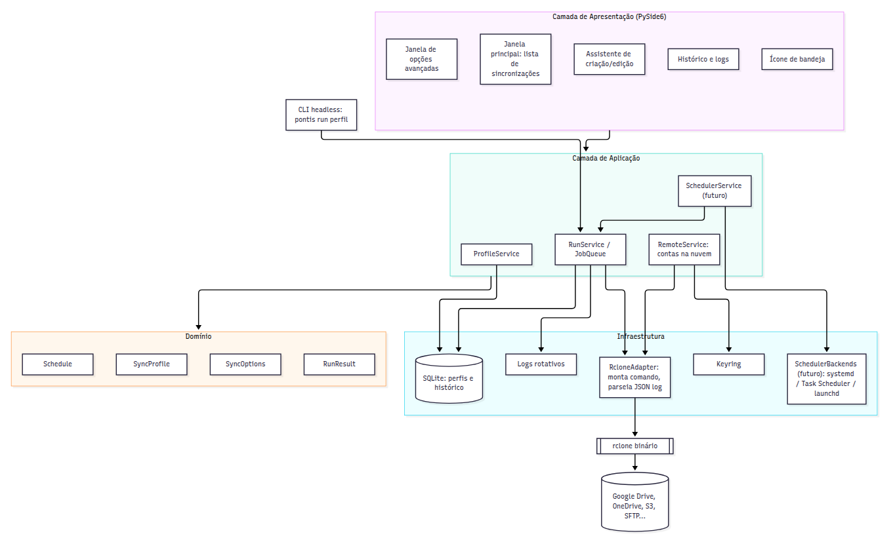
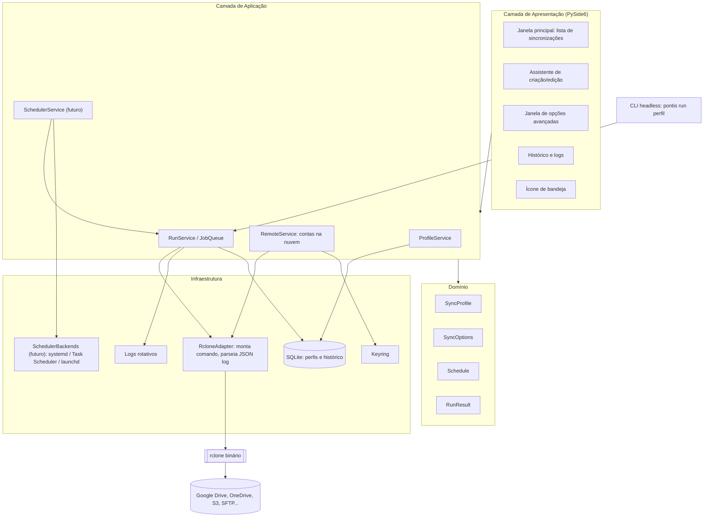
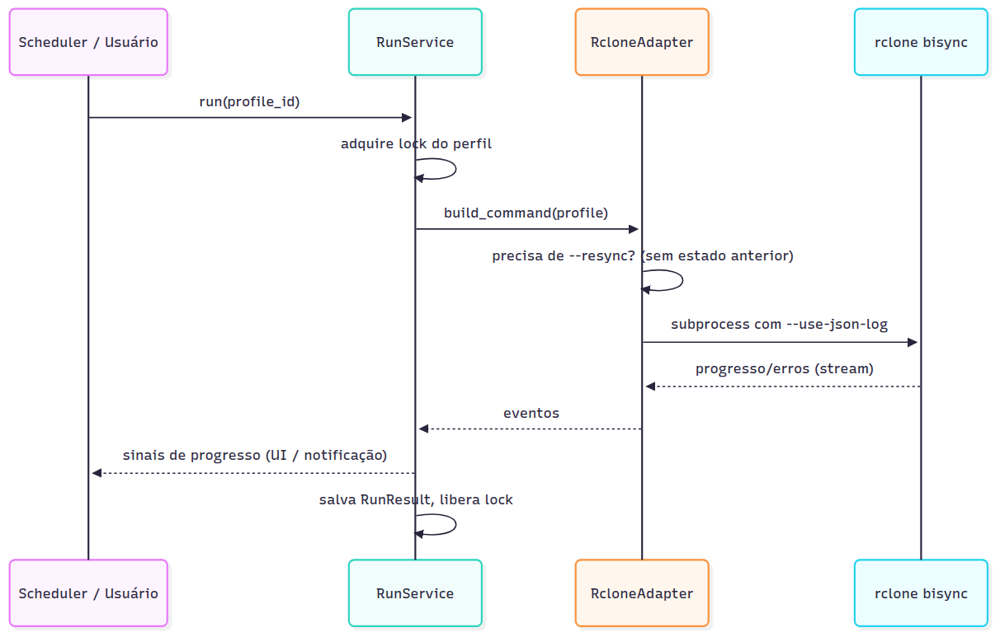
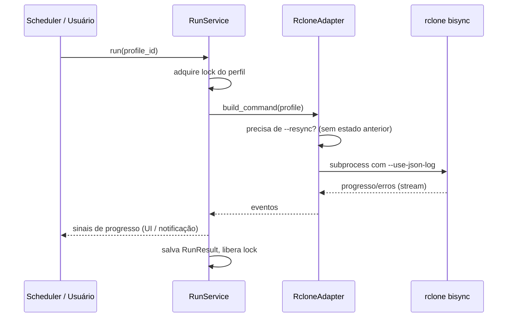

# Pontis — Proposta de Viabilidade e Arquitetura

> **Status: decisões fechadas (revisão 2).** Ver a seção [Decisões tomadas](#0-decisões-tomadas). O plano de execução está em [PLANO_DE_TRABALHO.md](PLANO_DE_TRABALHO.md).

## 0. Decisões tomadas

| Tema | Decisão |
|---|---|
| Motor de sincronização | **rclone** (`rclone bisync` como modo padrão) |
| Nome | **Pontis** |
| Agendamento | **Fora da v1**: sincronização apenas manual. A arquitetura deixa o ponto de extensão pronto (ver §3) |
| Distribuição do rclone | **Híbrida**: usa o rclone próprio do app, se houver; senão o do `PATH`; valida versão mínima; caminho configurável. Na v1 (Linux) detecta e orienta a instalação; o empacotamento fica para quando houver Windows/macOS |
| Licença | **GPL-3.0-or-later** |
| Plataformas | **Somente Linux na v1** (AppImage/Flatpak). Windows e macOS ficam para depois, sem retrabalho previsto |
| Persistência | **SQLite** (perfis e histórico) |
| Melhorias da §7 | Aprovadas |
| Custo | Nenhuma licença paga necessária para a v1 |

> Nome: **Pontis** (latim: "da ponte") — curto, pronunciável em PT/EN, remete a ligar duas pastas. Antes do lançamento, verificar disponibilidade do nome no GitHub/PyPI.

## 1. Viabilidade

**Veredito: viável**, com baixo risco técnico. O `sync.sh` atual já é o núcleo do app: o aplicativo vira uma interface gráfica + agendador + gerenciador de perfis em volta do `rclone bisync`.

| Requisito | Viabilidade | Observação |
|---|---|---|
| Desktop, Python | ✅ | Qt (PySide6) é a escolha mais madura. |
| Compilado | ✅ | PyInstaller (ou Nuitka) gera binário/AppImage, `.exe`, `.app`. Binários não são cross-compile: um build por SO (GitHub Actions faz isso). |
| Linux + Windows + macOS | ✅ | rclone e Qt são multiplataforma. O agendamento é o ponto que muda por SO (ver §3). |
| Multi-idioma PT/EN | ✅ | Qt Linguist (`.ts`/`.qm`) ou `gettext`. |
| Origem/destino local ou nuvem | ✅ | rclone suporta 70+ provedores (Drive, OneDrive, Dropbox, S3, SFTP, WebDAV…). |
| Sync bidirecional padrão | ✅ ⚠️ | `rclone bisync` ainda é marcado como **beta** pelo rclone (ver §2). |
| Opções avançadas | ✅ | Tela de flags com validação. |
| Agendamento (5 min, diário, semanal) | ✅ | Ver §3. |

## 2. Pontos de atenção

1. **Motor único: rclone.** Confirmado. Deve ficar explícito na documentação.
2. **`rclone bisync` é beta e exige cuidado.**
   - Primeira execução exige `--resync` (você já trata isso com `--primeira-vez`). No app: detectar automaticamente a ausência do estado (*listings*) e executar o resync inicial, com aviso.
   - Proteção contra perda de dados: usar `--max-delete` (padrão sugerido 50%), `--check-access` (arquivo `RCLONE_TEST`) e `--backup-dir`/lixeira para sobrescritas.
   - Se o bisync abortar por erro, ele exige `--resync` de novo; o app deve mostrar isso claramente e nunca repetir o resync automaticamente (pode apagar/duplicar dados).
   - Google Docs/Sheets nativos não têm tamanho/hash: exigem `--drive-export-formats` ou ignorá-los. Atenção também a diferenças de nomes (Windows/macOS são case-insensitive; caracteres proibidos).
3. **Concorrência.** Duas execuções do mesmo par ao mesmo tempo corrompem o estado. Necessário *lock* por perfil (rclone também usa lock, mas o app deve evitar o disparo).
4. **Execução automática é mais difícil do que parece.**
   - O agendador não pode depender da janela estar aberta → precisa de um *daemon/serviço em segundo plano* (bandeja do sistema) e/ou agendador nativo do SO.
   - Execução perdida (PC desligado/suspenso): política "executar ao voltar" (*catch-up*) ou "pular".
   - Evitar execução com bateria fraca, sem rede ou em conexão limitada (opções).
5. **Segurança e credenciais.**
   - Não armazenar tokens OAuth por conta própria. Delegar ao `rclone config` (arquivo `rclone.conf`). Recomendado: usar um **rclone.conf exclusivo do app** (`--config`) para não interferir no seu atual, com opção de importar o existente.
   - O `rclone.conf` pode ser criptografado (`RCLONE_CONFIG_PASS`); guardar a senha no *keyring* do SO (`keyring`).
   - Google exige *client_id* próprio para evitar limites de cota — documentar como criar.
6. **Autorização OAuth** abre navegador; o app precisa conduzir esse fluxo (`rclone config create ... ` / `rclone authorize`) e tratar falha/timeout.
7. **Distribuição do rclone (híbrida).** Ordem de busca: (1) rclone do app (empacotado/baixado), (2) rclone no `PATH`, (3) orientar instalação. Valida versão mínima suportada (`rclone version`) e permite caminho manual nas Preferências. Na v1 só os passos 2–3 são implementados; o rclone é MIT, então o empacotamento futuro é permitido.
8. **Licenças.** O projeto será **GPL-3.0-or-later**. Todas as dependências previstas (PySide6 LGPL, rclone MIT, keyring MIT, platformdirs MIT) são compatíveis. Manter um arquivo `THIRD_PARTY_LICENSES` e cabeçalhos SPDX nos arquivos-fonte. Ao distribuir rclone junto, incluir seu texto de licença.
9. **Assinatura de binários.** Não se aplica na v1 (Linux não exige). Para Windows/macOS no futuro: SmartScreen e notarização (Apple Developer Program, US\$ 99/ano) podem ser tratados depois.
10. **Logs e privacidade.** Logs podem conter nomes de arquivos; rotacionar, limitar tamanho e permitir exportar com mascaramento.
11. **Testes.** A lógica de agendamento e a montagem do comando devem ser testáveis sem GUI e sem rede (rclone local↔local em diretórios temporários serve para testes de integração).
12. **Conflitos.** Defina a política por perfil (`newer`, `larger`, `path1`, `path2`, manter ambos com renomeação). Sua escolha atual: `newer`. O padrão do app deveria ser "manter ambos" (mais seguro).

## 3. Estratégia de agendamento (fora da v1)

> **v1: somente execução manual.** Mesmo assim, o projeto já prepara o terreno:
> - a tabela `profiles` terá a coluna `schedule` (JSON, `NULL` = manual) e o domínio terá o modelo `Schedule` com apenas o tipo `manual`;
> - existirá a interface `SchedulerBackend` (sem implementação) e o `SchedulerService` ficará como esqueleto não ativado;
> - a execução sempre passa pelo `RunService` e pelo CLI `pontis run <perfil>`, que é exatamente o ponto que um agendador futuro chamará;
> - a interface não exibirá opções de agendamento até a funcionalidade existir.
>
> O desenho abaixo é a proposta para a versão futura.

Duas camadas, com o mesmo modelo de dados:

- **Padrão: agente interno** (processo em segundo plano com ícone na bandeja, iniciado no login) usando `APScheduler`. Igual em todos os SOs; suporta intervalos, diário, semanal, *catch-up*.
- **Opcional "rodar mesmo sem o app aberto": integração nativa** — `systemd --user timer` (Linux), Task Scheduler (Windows), `launchd` (macOS). Um módulo `scheduler_backends` com uma interface única.

Modo CLI headless (`pontis run <perfil>`) permite que ambos disparem a mesma execução.

## 4. Stack recomendada

| Camada | Escolha | Motivo |
|---|---|---|
| GUI | PySide6 (Qt 6) | Multiplataforma, bandeja, i18n nativo, aspecto profissional |
| Motor de sync | rclone (subprocesso, `--use-json-log`, `--stats`) | Já usado; progresso parseável |
| Agendador | *(futuro)* APScheduler + backends nativos opcionais | Ver §3; fora da v1 |
| Persistência | **SQLite** (`sqlite3` da stdlib, migrações versionadas) com caminhos via `platformdirs` | Perfis e histórico consultáveis |
| Segredos | `keyring` | Cofre do SO |
| Empacotamento | v1: PyInstaller (CI) → AppImage e Flatpak. Futuro: MSI/Inno Setup, DMG | |
| Qualidade | `pyproject.toml`, `ruff`, `mypy`, `pytest`, `pytest-qt`, `pre-commit`, GitHub Actions | |
| Idiomas | Qt Linguist (`pt_BR`, `en`) | Detecta idioma do SO, troca em runtime |

## 5. Arquitetura





### Fluxo de uma execução





### Estrutura do repositório

```
pontis/
├── pyproject.toml
├── README.md / README.pt-BR.md
├── LICENSE              # GPL-3.0-or-later
├── THIRD_PARTY_LICENSES.md
├── CHANGELOG.md  CONTRIBUTING.md  CODE_OF_CONDUCT.md  SECURITY.md
├── docs/                # arquitetura, guia do usuário, criação de client_id, ADRs
├── src/pontis/
│   ├── domain/          # modelos puros
│   ├── services/        # profile, run, remote (scheduler: futuro)
│   ├── infra/           # rclone, storage, keyring, os_scheduler
│   ├── ui/              # janelas, widgets, resources
│   ├── i18n/            # pt_BR.ts, en.ts
│   ├── cli.py
│   └── __main__.py
├── tests/               # unit, integration (rclone local), ui
├── packaging/           # pyinstaller.spec, appimage, inno, dmg
└── .github/workflows/   # CI (lint+test) e release (build por SO)
```

## 6. Telas

1. **Principal** — tabela de sincronizações: nome, origem ↔ destino, status, última execução; botões *Sincronizar agora*, editar, histórico.
2. **Assistente de criação** — nome → lado A (local/remoto, navegador de pastas) → lado B → direção (bidirecional padrão; também A→B, B→A) → política de conflito → resumo. (Passo de agendamento entra em versão futura.)
3. **Avançado** — filtros include/exclude (como seus `--exclude`), `max-delete`, `--check-access`, limites de banda, transferências paralelas, flags livres (com validação/lista de bloqueio), e *pré-visualização do comando*.
4. **Contas na nuvem** — adicionar/testar/remover remotos.
5. **Histórico/logs** — por execução, arquivos alterados, erros.
6. **Preferências** — idioma, caminho do rclone, tema (iniciar com o sistema e bandeja entram com o agendamento).

## 7. Melhorias sugeridas

- **Simulação (`--dry-run`)** obrigatória na primeira execução, mostrando o que será copiado/apagado.
- **Notificações** nativas em erro/conflito (bandeja: com o agendamento, futuro).
- **Importar `sync.sh`** existente: extrair pastas e `--exclude` e criar o perfil.
- **Tratamento de conflitos** com tela de resolução.
- **Limite de banda**; pausa em rede limitada/bateria e janela de horário (com o agendamento, futuro).
- **Perfis exportáveis/importáveis** (sem segredos), úteis para compartilhar.
- **Observação de mudanças em tempo real** (`watchdog`) para disparar sync ao salvar arquivos locais (com *debounce*).
- **Modo CLI** para scripts e servidores.
- **Atualização**: aviso de nova versão (GitHub Releases).
- **Acessibilidade e temas** claro/escuro.

## 8. Roteiro

O roteiro detalhado, em partes testáveis, está em [PLANO_DE_TRABALHO.md](PLANO_DE_TRABALHO.md).
